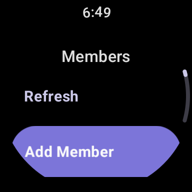

Members are the entries in your system roster. This page covers browsing the member list, creating a member, and editing a member's profile.

import { Tabs, TabItem } from '@astrojs/starlight/components';
import ThemeImage from '../../../../components/ThemeImage.astro';
import membersListLight from './members-list-light.png';
import membersListDark from './members-list-dark.png';
import addMemberLight from './members-add-member-light.png';
import addMemberDark from './members-add-member-dark.png';
import androidMembersLight from './android-members-light.png';
import androidMembersDark from './android-members-dark.png';

<Tabs syncKey="platform">
<TabItem label="Web">

## The members list

Open **"Members"** from the sidebar. Each member appears as a card showing their avatar, name, and pronouns. If a member has no avatar, the card shows their emoji or initial on their chosen color. Members with a display name set show it in place of their name, with the name underneath.

<ThemeImage
	light={membersListLight}
	dark={membersListDark}
	alt="The Members page on web, showing the member roster as a grid of cards with avatars, names, and pronouns, and the Add member button in the header."
/>

Entries marked as custom fronts (fronting states like "Asleep" or "Away") are listed in their own **"Custom fronts"** section below the roster, and archived members are hidden from the list entirely. Click any card to open the member's profile, which links to their journal and wall and is where you edit them.

## Creating a member

Click **"Add member"** in the page header. Only **"Name"** is required; everything else can be filled in later.

<ThemeImage
	light={addMemberLight}
	dark={addMemberDark}
	alt="The Add member dialog on web, with fields for avatar, banner, name, display name, emoji, and pronouns visible."
/>

The dialog scrolls; the full set of profile fields is:

- **"Name"** and an optional **"Display name"**, which is shown instead of the name if set.
- **"Pronouns"**, shown on the member's card and profile.
- **"Emoji"**, shown next to the name and used as the avatar fallback.
- **"Color"**, picked from a color swatch or entered as a hex code. Used as the background when there is no avatar.
- An avatar and a **"Banner"** image, each uploaded from a file or linked by URL.
- **"Birthday"**, with a no-birth-year option.
- **"Bio"**, a Markdown editor for the member's profile text.
- **"Notes"**, a separate Markdown scratchpad for quick-reference info. Unlike the bio, notes keep no revision history and are not protected by System Safety.
- **"PluralKit ID"**, if you cross-reference this member with PluralKit.
- **"Privacy"** (see below).
- **"Custom front (not a member)"**, which marks the entry as a fronting state rather than a member. Custom fronts can still front and be in groups, but don't count toward member statistics.
- **"Pin to quick-switch"**, which keeps the member at the top of the start-front quick-pick list.

Fill in what you want and submit with the button at the bottom of the dialog.

## Editing a member

Click a member's card, then **"Edit"** in their profile. The **"Edit member"** dialog has the same fields as the create dialog, plus a **"Custom fields"** section when your system has custom fields defined: each field gets an input matching its type (text, number, date, checkbox, or a choice list). Click **"Save"** to apply profile changes; custom field changes are saved separately with their own button.

Edits to the bio keep revision history: open the member's profile and use **"History"** to browse, restore, or pin past versions. Tags are also managed from the profile, under **"Tags"**.

The edit dialog is also where **"Archive member"** and **"Delete member"** live. Archiving hides a member from the roster and pickers while keeping them in front history and journals, and can be undone from settings; deleting is permanent (subject to your System Safety settings).

## Member privacy

Each member has a **"Privacy"** level, set from the create and edit dialogs: **"Private"**, **"Friends only"**, or **"Public"**. New members default to **"Private"**.

</TabItem>
<TabItem label="Android">

## The Members tab

Open **"Members"** in the bottom navigation. A segmented control at the top switches between the **"Members"** and **"Groups"** lists; the members side shows each member as a card with their avatar, name, and pronouns. Members with a display name set show it in place of their name, and if a member has no avatar the card shows their initial on their chosen color. Archived members are hidden from the list; they are viewed and restored from **"Settings"**. Unlike web, custom fronts appear in the list alongside members rather than in their own section.

<ThemeImage
	light={androidMembersLight}
	dark={androidMembersDark}
	alt="The Members tab on Android, with the Members and Groups segmented control, member cards with avatars, names, and pronouns, and the search and add buttons floating in the bottom corner."
/>

The search button above the add button opens a **"Search members"** box, which matches against member names and pronouns.

## Creating and editing members

Tap the add button (**"Add member"**) to create a member on the **"New Member"** screen. As on web, only the name is required and everything else can be filled in later.

Tap any card to open the member's profile, which shows their banner, avatar, bio, notes, and profile details. The edit button in the profile's top bar opens the member for editing, and **"Bio history"** browses past bio revisions.

</TabItem>
<TabItem label="Wear OS">

## Members on the watch

The watch app opens on a menu; pick **"Members"** to see your roster. Each member appears as a chip with their avatar, name, and pronouns, and members who are currently fronting are highlighted. Members with a display name set show it in place of their name, and if a member has no avatar the chip shows their emoji, or their initials, on their chosen color. The **"Refresh"** chip pulls the latest roster from the server.

Tap a member to open their profile, which shows their avatar, name, pronouns, whether they are **"Currently fronting"**, and their bio as plain text.

## Adding a member from the watch

Pick **"Add Member"** at the top of the list. The watch form is minimal: a required name, plus optional display name and pronouns. Confirm with **"Add"**, or back out with **"Cancel"**. Everything else on the member's profile can be filled in later from the phone or web.

</TabItem>
</Tabs>
