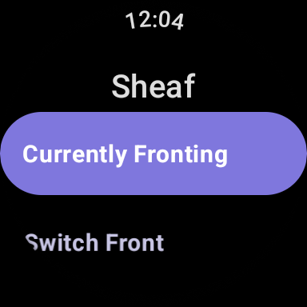
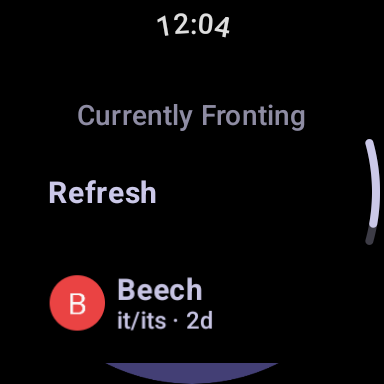
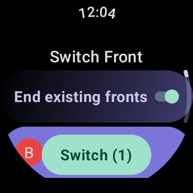
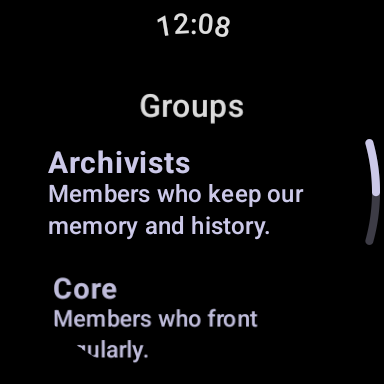
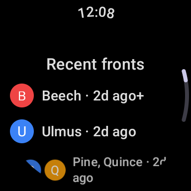
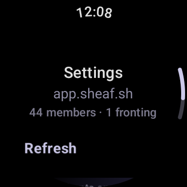

Sheaf's Wear OS app puts fronting on your wrist: see who is at the front,
record a switch, and browse your members without reaching for your phone.

import { Tabs, TabItem } from '@astrojs/starlight/components';

<Tabs syncKey="platform">
<TabItem label="Wear OS">

The watch app is a full Sheaf client. It talks to your Sheaf server over
the watch's own connection, so once you are signed in it works with the
paired phone out of reach - the phone just makes sign-in and offline
syncing easier.

## Getting the app

If you install Sheaf from the Play Store, the watch app is published there
alongside the phone app. If you prefer a build with no Google dependencies,
every [GitHub release](https://github.com/sheaf-project/android/releases)
also includes a wear `.open` APK you can sideload onto the watch.

## Signing in

The easy path is through your phone: the watch shows
**"Open Sheaf on your phone to sign in"**, and signing in to the phone app
syncs your credentials across to the watch, which moves on to the menu by
itself once they arrive. **"Open on phone"** brings up the Sheaf app on
your paired phone so you can sign in there. If the watch has not picked
the credentials up yet, **"Retry Sync"** asks the phone again.

To use the watch without the phone app, choose **"Sign in manually"**
instead and enter your server URL, email, and password directly on the
watch, then confirm with **"Sign In"**. **"Cancel"** returns to the sync
screen.

## The menu

The app opens on a menu of the watch app's six areas.

- **"Currently Fronting"**: who is at the front right now.
- **"Switch Front"**: record a switch.
- **"Members"**: browse your members, or add one.
- **"Groups"**: your groups and who is in them.
- **"History"**: your recent fronts.
- **"Settings"**: server info, the switch default, and sign out.

## See who's fronting

The **"Currently Fronting"** screen lists a chip for each fronting member
with their avatar, pronouns, and how long they have been at the front.
**"Refresh"** re-syncs with your server, and a **"Switch Front"** chip at
the bottom jumps straight to the switch screen. When no front is active,
the screen reads **"No one fronting"**.

## Switch from your wrist

On the **"Switch Front"** screen, the current fronters start out selected,
and the members you switch to most often are listed first. Tap member
chips to select whoever is arriving and deselect whoever is stepping back. Selecting more than one member records co-fronting. Leave
**"End existing fronts"** on to make it a switch, or turn it off to start
the new front alongside the active ones; the toggle starts from your
default in Settings. The confirm chip at the bottom shows how many members
are selected - tap it to commit. Deselect everyone and the same chip
reads **"Clear Front"** and clears the front instead. If exactly those
members are already fronting, the watch shows **"Already fronting"** and
leaves the front as it is.

The watch keeps switching deliberately simple; for custom statuses,
filters, and everything else around switches, see
[Switching who's fronting](/guides/fronting/switching/).

## Members and groups

**"Members"** lists your members with pronouns, highlighting whoever is
currently fronting. Tap a member to see their profile: avatar, name,
pronouns, and description, plus a **"Currently fronting"** note when they
are at the front. Profiles are read-only on the watch, but you can create
a member: **"Add Member"** opens a short form for a name and optional
display name and pronouns.

**"Groups"** lists your groups with their descriptions. Open a group to
see which members are in it; the same screen lets you tick members in or
out of the group and save the change.

## History

**"History"** shows your recent fronts under the **"Recent fronts"**
heading, newest first: the avatars and names of each fronting set with how
long ago it started. A plus after the time marks the front that is still
running. History on the watch is read-only; editing past fronts happens on
the other platforms.

## Settings

**"Settings"** shows which server the watch is signed in to and a member
and fronting count, with a **"Refresh"** chip to re-sync. The
**"End fronts on switch"** toggle is the **"Default for the switch screen"**,
and **"Sign Out"** (with a confirmation step) signs the watch out. The watch
then stays signed out, even though your phone is still signed in, until
you tap **"Retry Sync"** or sign in manually. Signing out of the phone app
signs the watch out too. The app version sits at the bottom.

## Switching while offline

A switch made on the watch goes straight to your server when the watch has
a connection. If the server cannot be reached, the watch hands the switch
to your phone, which delivers it as soon as it can. If the phone cannot be
reached either, the switch is queued on the watch itself and sent on the
next refresh. Queued switches keep their original time, so the front is
recorded from the moment you switched, not the moment the watch got back
online. A switch the server reached but turned down is not queued; the
switch screen shows the error instead.

## Tiles and complications

Sheaf also works without opening the app: it provides watch tiles and
watch-face complications for fronting at a glance and quick switching.

Tiles (added from the watch's tile carousel):

- **Fronters list**: the names of the current fronters.
- **Fronters + faces**: fronter avatars with names underneath.
- **Fronter faces**: fronter avatars only, for a purely visual read.
- **Member tracker**: tap the new tile to pick members; each shows a
  fronting indicator.
- **Quick switch**: tap the new tile to pick a roster, then select
  members and commit a switch directly from the tile. If those members
  are already fronting, the tile tells you so instead of switching.
- **Recent fronts**: a timeline of your latest switches.

You can add any tile more than once, and each copy keeps its own member
choice - for example, two **Member tracker** tiles following different
members. On watches whose tile editor offers settings for a tile, those
settings open the member picker for that copy. The fronter tiles and
**Recent fronts** show everyone until you pick members for them; after
that, that copy shows only those members, and **Recent fronts** keeps any
entry that includes one of them.

Complications (added to a watch-face slot):

- **Sheaf**: a shortcut that opens the app.
- **Sheaf: Switch**: a shortcut straight to the switch screen.
- **Sheaf: Fronters (oldest first)** and **Sheaf: Fronters (newest first)**:
  the current fronters' names. Small slots show the first name plus how
  many others are fronting.
- **Sheaf: Fronting duration**: how long the longest-running current
  fronter has been at the front.
- **Sheaf: Last switch**: how long since the fronting set last changed.
- **Sheaf: Is X fronting?**: pick one member; shows whether they are
  fronting right now.

</TabItem>
</Tabs>
